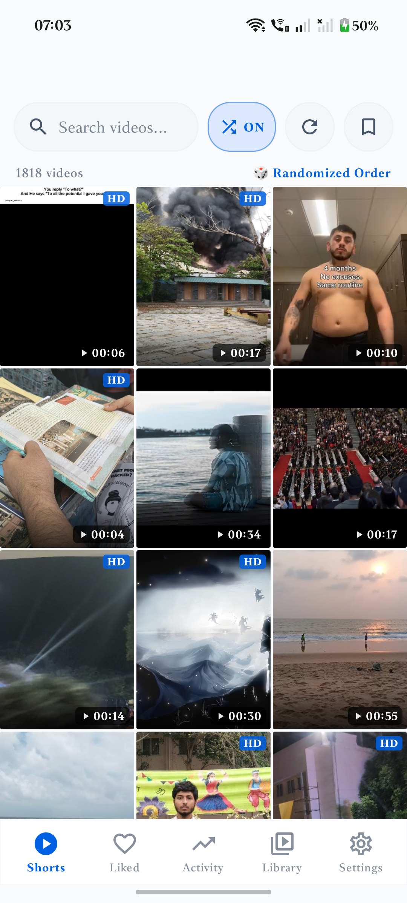
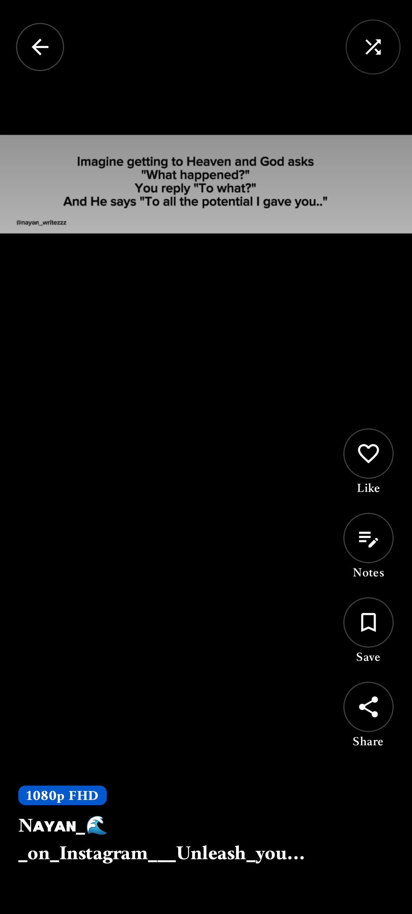
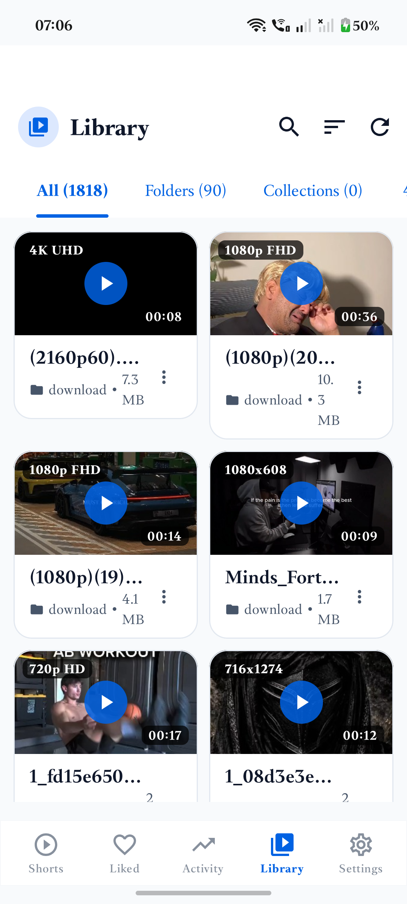
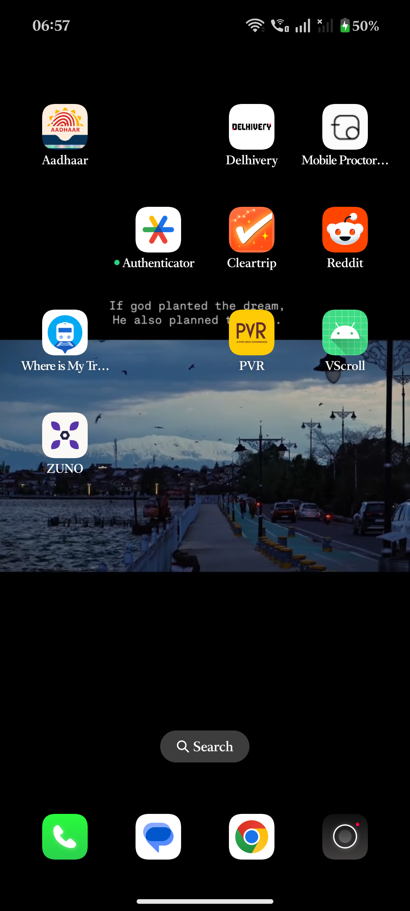
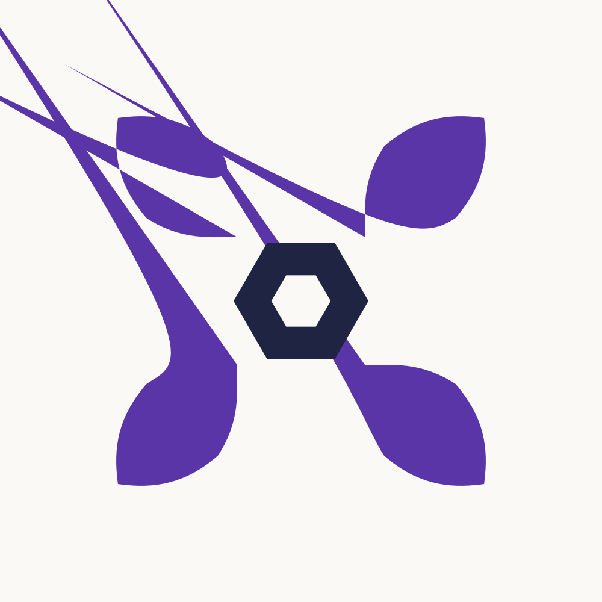
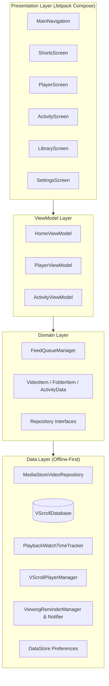

<p align="center">
  
</p>

<p align="center">
  <strong>The Offline-First Social Video Discovery Platform for Android</strong>
</p>

<p align="center">
  <a href="#technology-stack"></a>
  <a href="#technology-stack"></a>
  <a href="#technology-stack"></a>
  <a href="#technology-stack"></a>
  <a href="#technology-stack"></a>
  <a href="#privacy-and-offline-philosophy"></a>
  <a href="#automated-testing"></a>
</p>

---

## Table of Contents
1. [Project Overview](#project-overview)
2. [Product Vision](#product-vision)
3. [Offline-First Philosophy & Privacy](#offline-first-philosophy--privacy)
4. [Visual Previews & Screenshots](#visual-previews--screenshots)
5. [Key Features](#key-features)
6. [ZUNO Brand Identity & Color Palette](#zuno-brand-identity--color-palette)
7. [Technology Stack](#technology-stack)
8. [Architecture Overview](#architecture-overview)
9. [Project Folder Structure](#project-folder-structure)
10. [Application Navigation](#application-navigation)
11. [Playback Architecture & Isolated Queues](#playback-architecture--isolated-queues)
12. [Media3 & ExoPlayer Lifecycle](#media3--exoplayer-lifecycle)
13. [MediaStore Integration & Local Media Access](#mediastore-integration--local-media-access)
14. [Room Database & Schema Migrations](#room-database--schema-migrations)
15. [Likes, Bookmarks & Private Notes](#likes-bookmarks--private-notes)
16. [Watch History & Activity Analytics](#watch-history--activity-analytics)
17. [Viewing Reminders & Notification Behavior](#viewing-reminders--notification-behavior)
18. [Folder & Virtual Collection Management](#folder--virtual-collection-management)
19. [Theme System & DataStore Persistence](#theme-system--datastore-persistence)
20. [Permissions & Android Scoped Storage](#permissions--android-scoped-storage)
21. [Build Requirements & Setup](#build-requirements--setup)
22. [How to Build & Test](#how-to-build--test)
23. [Installation & Safe In-Place Updates](#installation--safe-in-place-updates)
24. [Troubleshooting & Limitations](#troubleshooting--limitations)
25. [Contribution Guidelines](#contribution-guidelines)
26. [License Placeholder](#license-placeholder)
27. [Detailed Documentation Links](#detailed-documentation-links)

---

## 1. Project Overview

**ZUNO** is a high-performance, offline-first native Android application designed to transform how users experience their local short-form videos. Built entirely with modern Android technologies—Kotlin Coroutines, Jetpack Compose, Material 3, AndroidX Media3 ExoPlayer, and Room SQLite Database—ZUNO delivers the addictive, frictionless fluid swipe experience of modern social media platforms directly to your private local video library.

No feeds dictated by ad algorithms. No cloud logins. No background tracking. Just your videos, beautifully organized and instantly playable.

---

## 2. Product Vision

Modern video platforms offer fluid, immersive interfaces, but lock users into engagement algorithms, tracking networks, and cloud dependencies. ZUNO extracts the finest interaction paradigms of modern short-form discovery—vertical swipe feeds, explore discovery grids, double-tap hearts, and volume/brightness scrubbing—and applies them to local device storage. 

ZUNO treats short video viewing with respect: rather than gamifying your watch time with addictive streaks or goals, ZUNO provides transparent viewing analytics and health-conscious **Viewing Reminders** to help you stay mindful of your digital balance.

---

## 3. Offline-First Philosophy & Privacy

- **100% Offline & Private:** Zero internet permissions required for core features. All discovery, playback, interactions, and analytics run solely on-device.
- **No Cloud Synchronization or Remote Telemetry:** Your watch history, notes, and liked videos never leave your local hardware.
- **Scoped Storage Compliance:** Accesses only video files using Android's modern `MediaStore` content provider APIs, keeping user documents and files inaccessible.
- **Airplane Mode Ready:** Verified for full operational reliability in complete offline environments.

---

## 4. Visual Previews & Screenshots

| Shorts Explore Grid | Immersive Video Player | Activity & Break Reminders |
| :---: | :---: | :---: |
|  |  |  |

| Library & Collections | Settings & About ZUNO | Launcher Icon Preview |
| :---: | :---: | :---: |
|  |  |  |

---

## 5. Key Features

- **Shorts Discovery Grid:** A 3-column discovery feed with dynamic thumbnail generation, duration badges, and HD resolution tags.
- **Randomized Shuffle Feed:** Session-stable Fisher-Yates shuffle engine ensuring fresh discovery without immediate repeats.
- **Gesture-Driven Playback:** Vertical swipe to change videos, single tap to play/pause, double tap to like, left vertical slide for brightness, right vertical slide for volume, and horizontal drag to seek.
- **Clean Viewing Mode:** One-tap distraction-free view hiding all HUD overlays, buttons, and navigation bars.
- **Offline Interactions:** Like, bookmark, and write private notes for any local video; reviewed easily in the Interactions tab.
- **Health-Conscious Viewing Reminders:** Configurable reminders (15m, 30m, 45m, 60m) that send a gentle, non-judgmental local Android notification when accumulated daily watch time reaches the threshold.
- **Activity Analytics:** 7-day watch activity breakdown, session counts, lifetime stats, and most-rewatched ranking.
- **Physical Folders & Virtual Collections:** Manage physical device storage directories or curate virtual multi-folder playlists.
- **Multi-Select Batch Actions:** Batch like, batch add to collection, batch share via native sharesheet, or batch delete with Android system confirmation.
- **Six Design Themes:** Featuring signature brand **ZUNO** theme plus Ocean Pop, Sunset Glow, Fresh Mint, Lavender Dream, and Midnight Dark.

---

## 6. ZUNO Brand Identity & Color Palette

<p align="center">
  
</p>

ZUNO is built around an intentional three-color signature palette engineered for accessible contrast, visual warmth, and optical equilibrium:

| Color Name | Hex Code | Compose Token | Role & Usage |
| :--- | :--- | :--- | :--- |
| **Rich Violet** | `#5935A8` | `ZunoPrimary` | Primary brand actions, active icons, progress bars |
| **Midnight Navy** | `#202443` | `ZunoSecondary` | Dark structural elements, primary text, headings |
| **Warm Ivory** | `#FAF9F6` | `ZunoBackground` | Canvas background, card containers, neutral surfaces |

For design rationale, geometry specifications, and Android adaptive icon details, see [docs/BRANDING.md](docs/BRANDING.md).

---

## 7. Technology Stack

- **Language:** Kotlin 2.0.21 (JVM Toolchain 17)
- **UI Framework:** Jetpack Compose & Material 3 (1.3.x)
- **Architecture:** Clean Architecture + Unidirectional Data Flow (UDF) + MVVM
- **Video Engine:** AndroidX Media3 ExoPlayer 1.5.1
- **Local Database:** Android Room 2.7.0-alpha13 (SQLite) with safe migrations
- **Preferences:** Jetpack DataStore Preferences 1.1.2
- **Image Loading:** Coil 2.7.0 (Compose video frame decoding)
- **Build System:** Gradle 9.1.0 + Android Gradle Plugin (AGP) 8.9.0 + KSP 2.0.21-1.0.28
- **Testing:** JUnit 4, Kotlin Coroutines Test, Mockito

---

## 8. Architecture Overview



For full architectural details, see [docs/ARCHITECTURE.md](docs/ARCHITECTURE.md).

---

## 9. Project Folder Structure

```
D:\Projects\VScroll/
├── app/
│   ├── src/
│   │   ├── main/
│   │   │   ├── AndroidManifest.xml
│   │   │   ├── kotlin/com/binay/vscroll/
│   │   │   │   ├── MainActivity.kt
│   │   │   │   ├── MainNavigation.kt
│   │   │   │   ├── data/
│   │   │   │   │   ├── local/              # Room Database, Entities, DAOs, Migrations
│   │   │   │   │   ├── notification/       # ViewingReminderManager & Notifier
│   │   │   │   │   ├── player/             # ExoPlayer Manager, WatchTimeTracker
│   │   │   │   │   ├── preferences/        # Theme & Activity DataStore
│   │   │   │   │   └── repository/         # MediaStore & WatchHistory Repositories
│   │   │   │   ├── domain/
│   │   │   │   │   ├── model/              # Immutable domain data models
│   │   │   │   │   └── repository/         # Repository contracts & FeedQueueManager
│   │   │   │   └── ui/
│   │   │   │       ├── activity/           # Activity analytics & viewing reminders
│   │   │   │       ├── components/         # Reusable Compose widgets
│   │   │   │       ├── home/               # Home screen & navigation tabs
│   │   │   │       ├── library/            # Library, folders, collections
│   │   │   │       ├── liked/              # Likes, saves, private notes
│   │   │   │       ├── player/             # Fullscreen video player & gestures
│   │   │   │       ├── settings/           # App settings & about section
│   │   │   │       └── theme/              # Color schemes, typography, theme dialog
│   │   │   └── res/                        # Drawables, mipmaps, values, xml paths
│   │   └── test/                           # 100 automated unit test cases
│   └── build.gradle.kts
├── docs/                                   # Detailed documentation & visual assets
│   ├── assets/                             # Branding assets & screenshots
│   ├── ARCHITECTURE.md
│   ├── BRANDING.md
│   ├── BUILD_AND_INSTALLATION.md
│   ├── DATABASE.md
│   ├── FEATURES.md
│   ├── PLAYBACK.md
│   ├── PRIVACY_AND_PERMISSIONS.md
│   └── TESTING.md
├── build.gradle.kts
├── settings.gradle.kts
└── README.md
```

---

## 10. Application Navigation

Navigation is managed via Compose Navigation across five bottom destinations:

1. **Shorts:** Explore 3-column discovery grid opening into fullscreen immersive playback.
2. **Liked:** Interaction hub with segment filters for Liked videos, Bookmarks, and Private Notes.
3. **Activity:** Viewing reminders, daily watch time gauge, 7-day breakdown, and watch history list.
4. **Library:** Comprehensive video catalog partitioned into *All Videos*, *Physical Folders*, and *Virtual Collections*.
5. **Settings:** Active theme selector, clean viewing mode toggle, MediaStore rescan trigger, and About ZUNO dialog.

---

## 11. Playback Architecture & Isolated Queues

ZUNO strictly enforces **playback queue isolation** via `FeedQueueManager`. When entering playback, the active queue is isolated to that specific source context:

- **`GlobalRandomFeed`:** Plays from the entire local video library in a randomized shuffle order.
- **`FolderSequential`:** Confined strictly to videos within that physical storage folder. Swiping next or previous cannot escape into unrelated videos.
- **`CollectionSequential`:** Confined strictly to videos tagged within that virtual collection.

For sequence diagrams and queue management details, see [docs/PLAYBACK.md](docs/PLAYBACK.md).

---

## 12. Media3 & ExoPlayer Lifecycle

- **Single Active ExoPlayer:** Maintains exactly one hardware-accelerated playback instance to conserve memory.
- **Audio Focus:** Handles focus loss automatically (pausing during phone calls, resuming smoothly).
- **Background Release:** Immediately ceases decoder activity on app backgrounding or screen off.
- **Aspect Scaling:** Supports automatic switching between `FIT` and `ZOOM` aspect ratios.

---

## 13. MediaStore Integration & Local Media Access

- **ContentResolver Querying:** Queries `MediaStore.Video.Media.EXTERNAL_CONTENT_URI` to discover video files.
- **Dynamic Content Observers:** Reactively updates when new videos are downloaded or deleted outside the app.
- **Cached Metadata:** Extracts resolution, duration, folder name, file size, and timestamps directly into immutable domain items.

---

## 14. Room Database & Schema Migrations

The SQLite database (`vscroll_database.db`) is managed via Room v4 with strict, non-destructive migration scripts:

- **`MIGRATION_1_2`:** Added `liked_videos`, `saved_videos`, and `video_notes` tables.
- **`MIGRATION_2_3`:** Added `watch_history` and `daily_watch_records` tables.
- **`MIGRATION_3_4`:** Added `collections`, `collection_items`, and `folder_custom_names` tables.

For full database schema diagrams and SQL definitions, see [docs/DATABASE.md](docs/DATABASE.md).

---

## 15. Likes, Bookmarks & Private Notes

- **Likes:** Stored in `liked_videos`. Triggered via heart button or double-tap heart gesture.
- **Bookmarks:** Stored in `saved_videos`. Instant offline saving for later viewing.
- **Private Notes:** Stored in `video_notes`. Write personal thoughts or time-codes attached to any video.
- All interactions remain strictly on-device in SQLite.

---

## 16. Watch History & Activity Analytics

- **`watch_history` Table:** Maintains lifetime aggregate metrics per video (first watched, last watched, session counts, total elapsed time).
- **`daily_watch_records` Table:** Granular records partitioned by date (`YYYY-MM-DD`). Automatically splits sessions that span across midnight.
- **7-Day Bar Chart:** Visualizes viewing trends across the preceding week.

---

## 17. Viewing Reminders & Notification Behavior

Replacing gamified goals and streaks, ZUNO features a mindful **Viewing Reminder**:

- **Intervals:** 15 minutes, 30 minutes, 45 minutes, 60 minutes, or Disabled.
- **Eligible Watch Time:** `PlaybackWatchTimeTracker` counts only foreground active playback (excluding pause, buffering, background, or lock screen time).
- **Gentle Notification:** When accumulated daily time reaches the threshold, ZUNO sends a calm Android notification:
  - *Title:* `Take a little break`
  - *Body:* `You've been watching for 30 minutes. Would you like to pause for a while?`
- **Deduplication:** Notifies only once per threshold window per calendar day. Re-arms cleanly on date change.

---

## 18. Folder & Virtual Collection Management

- **Physical Folders:** Mirrors real storage directories. Supports physical folder creation and folder renaming where Android storage permissions permit.
- **Virtual Collections:** Curated lists created inside the app. A video can belong to multiple collections without copying or moving physical files.
- **Collection Playback:** Dedicated player queue isolated to the selected collection.

---

## 19. Theme System & DataStore Persistence

ZUNO features six cohesive color themes:
1. **ZUNO (Default):** Rich violet, midnight navy, warm ivory.
2. **Ocean Pop:** Electric blue, sky blue, crisp white.
3. **Sunset Glow:** Vibrant coral, orange, warm peach.
4. **Fresh Mint:** Mint green, emerald, lively white.
5. **Lavender Dream:** Royal lavender, violet, soft pink.
6. **Midnight (Dark):** Obsidian black, electric cyan, violet.

Theme selection is persisted in Jetpack DataStore (`vscroll_settings.preferences_pb`) and animated dynamically upon selection.

---

## 20. Permissions & Android Scoped Storage

ZUNO requests minimal permissions:
- `READ_MEDIA_VIDEO` (Android 13+) / `READ_EXTERNAL_STORAGE` (Android 8–12): Index local video files.
- `READ_MEDIA_VISUAL_USER_SELECTED` (Android 14+): Partial media access support.
- `POST_NOTIFICATIONS` (Android 13+): Deliver local viewing reminders.

For a full security and permission breakdown, see [docs/PRIVACY_AND_PERMISSIONS.md](docs/PRIVACY_AND_PERMISSIONS.md).

---

## 21. Build Requirements & Setup

- **JDK:** Version 17
- **Android SDK:** Compile SDK 37, Target SDK 37, Min SDK 26
- **Gradle:** 9.1.0 with AGP 8.9.0

For step-by-step setup instructions, see [docs/BUILD_AND_INSTALLATION.md](docs/BUILD_AND_INSTALLATION.md).

---

## 22. How to Build & Test

### Assemble Debug APK
```powershell
.\gradlew.bat assembleDebug
```
Output: `app/build/outputs/apk/debug/app-debug.apk`

### Run Automated Tests
```powershell
.\gradlew.bat test
```
Result: **102 / 102 tests passing (100% pass rate)**. See [docs/TESTING.md](docs/TESTING.md) for details.

---

## 23. Installation & Safe In-Place Updates

### Install via ADB
```powershell
adb install -r app\build\outputs\apk\debug\app-debug.apk
```
> [!IMPORTANT]
> Always use the `-r` flag to perform an **in-place update**. Never uninstall the app prior to updating, as Android will delete the private SQLite database and DataStore preferences.

### Standalone Distributable APK
A pre-built standalone APK is available at:
`D:\Projects\ZUNO-Release\ZUNO-debug.apk`

- **File Size:** 25,258,049 bytes (24.08 MB)
- **SHA-256:** `468DF141D8D3CB706BD44176FAF93F89B2D3523B3E2AF79EB7FC8CCAED45591A`

---

## 24. Troubleshooting & Limitations

- **Hardware Codec Constraints:** Playback capability depends on device hardware decoders (e.g., 4K 60fps/10-bit playback requires supported device hardware).
- **Storage Permission Required:** Videos will not populate until storage access is granted in Android system settings.
- **Android Scoped Storage Restrictions:** File renaming and deletion on external SD cards require Android system SAF consent prompts.

---

## 25. Contribution Guidelines

Contributions are welcome! Please follow these standards:
1. Ensure all code conforms to Kotlin coding conventions.
2. Run `.\gradlew.bat test` to confirm all 102 tests pass without regression.
3. Preserve the offline-first, zero-tracking philosophy.

---

## 26. License Placeholder

*Note: An open-source license has not yet been selected for this project.*

---

## 27. Detailed Documentation Links

- [docs/ARCHITECTURE.md](docs/ARCHITECTURE.md) — System layers, state flow, and component relationships.
- [docs/DATABASE.md](docs/DATABASE.md) — Room database schemas, indices, and migration history.
- [docs/PLAYBACK.md](docs/PLAYBACK.md) — Media3 ExoPlayer lifecycle, gestures, and isolated queues.
- [docs/FEATURES.md](docs/FEATURES.md) — Complete feature catalog and user flows.
- [docs/BUILD_AND_INSTALLATION.md](docs/BUILD_AND_INSTALLATION.md) — Step-by-step compilation, ADB deployment, and sideloading guide.
- [docs/PRIVACY_AND_PERMISSIONS.md](docs/PRIVACY_AND_PERMISSIONS.md) — Privacy manifesto and Scoped Storage security model.
- [docs/BRANDING.md](docs/BRANDING.md) — Brand guidelines, geometry, and design tokens.
- [docs/TESTING.md](docs/TESTING.md) — Automated test suite specifications and device verification matrix.

