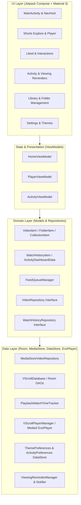

# ZUNO — System Architecture

## 1. Architectural Philosophy

ZUNO is architected following the **Clean Architecture** and **Unidirectional Data Flow (UDF)** patterns recommended for modern Android engineering. It is strictly **offline-first**: all video indexing, playback state, interactions, analytics, and preferences are processed and stored on-device without cloud synchronization, user accounts, or background tracking.

---

## 2. Layer Breakdown

### A. UI Layer (`com.binay.vscroll.ui`)
- **Jetpack Compose & Material 3:** Declarative UI built exclusively with Compose composables.
- **Single Activity Architecture:** Hosted in `MainActivity.kt`, routed via Compose Navigation.
- **Dynamic Theming:** Dynamic color scheme animation (`VScrollTheme`) observing preferences via `StateFlow`.
- **Gesture Architecture:** Vertical swipe for feed navigation, horizontal drag for progress seeking, left/right vertical drags for brightness and volume HUDs, double-tap for animated likes.

### B. ViewModel Layer (`com.binay.vscroll.ui.*`)
- **`HomeViewModel`:** Coordinates media discovery, virtual collections, physical folders, multi-select batch actions, and theme settings.
- **`PlayerViewModel`:** Encapsulates ExoPlayer lifecycle, Clean Viewing Mode state, interaction buttons, and watch-time telemetry.
- **`ActivityViewModel`:** Exposes reactive watch analytics, viewing reminder configuration, and watch history clearing.

### C. Domain Layer (`com.binay.vscroll.domain`)
- **Immutable Domain Models:** `VideoItem`, `FolderItem`, `CollectionItem`, `WatchHistoryItem`, `ActivityDashboardData`.
- **Feed Queue Manager (`FeedQueueManager`):** Isolates playback queues based on source context.
- **Repository Contracts:** Clean interfaces decoupling business logic from Android framework APIs.

### D. Data Layer (`com.binay.vscroll.data`)
- **Local Database (`VScrollDatabase`):** Room SQLite database storing likes, bookmarks, notes, watch history, daily records, collections, and folder metadata.
- **MediaStore Video Repository (`MediaStoreVideoRepository`):** Scans device video content via Android `ContentResolver`, respecting Android Scoped Storage.
- **Media3 Playback (`VScrollPlayerManager`):** Manages ExoPlayer instances, hardware renderers, audio focus, and aspect ratio sizing.
- **DataStore Repositories:** Type-safe key-value preferences for themes, shuffle state, clean viewing mode, and viewing reminders.
- **Notification Services:** Local break reminders delivered via `ViewingReminderNotifier` and Android `NotificationChannel`.

---

## 3. High-Level Data Flow

1. **Discovery:** When granted `READ_MEDIA_VIDEO` / `READ_EXTERNAL_STORAGE`, `MediaStoreVideoRepository` queries Android's `MediaStore.Video.Media` query table.
2. **Persistence:** Videos, interactions, and playback metrics are continuously synchronized with the local SQLite database via Room.
3. **Queue Isolation:** When the user enters playback, the active queue is determined by context (`GLOBAL_RANDOM`, `FOLDER_SEQUENTIAL`, or `COLLECTION_SEQUENTIAL`), ensuring users stay within their intended scope.
4. **Watch Tracking:** Foreground playback ticks are captured by `PlaybackWatchTimeTracker` and flushed every 5 seconds to `daily_watch_records`.
5. **Viewing Reminders:** `ViewingReminderManager` evaluates accumulated daily watch time against the user's selected interval and dispatches a gentle local notification when reached.

---

## 4. Performance & Resource Optimization

### MediaStore Query & Cache Architecture
- **Thread Safety & In-Memory Cache:** `MediaStoreVideoRepository` maintains a volatile in-memory cache with timestamp invalidation. Concurrent collectors (such as `videos` and `folders` flows) share query results without issuing duplicate ContentResolver queries across Android IPC.
- **Single-Pass Folder Grouping:** Replaced multi-pass grouping with a lightweight `FolderAccumulator` map. Groups 1,818 videos into 90 folders in ~13ms with minimal heap allocations.
- **Pre-Allocated Capacity:** Sized internal array structures based on cursor counts (`cursor.count`), avoiding repeated array reallocations during library indexing.

### Media3 ExoPlayer Decoders & Rendering
- **MediaCodec Decoder Retention:** Direct item replacement via `setMediaItem(mediaItem, resetPosition = true)` without `activePlayer.stop()` teardown, preserving initialized codec buffers across swipes.
- **Track Selection Quality Enforcers:** Explicit `DefaultTrackSelector` configuration enforcing highest bitrate and resolution capabilities.
- **Predictive Surface Composition:** `VerticalPager(beyondViewportPageCount = 1)` and asynchronous thumbnail preloading via `ThumbnailLoader` ensures instant frame delivery upon scroll gestures.

