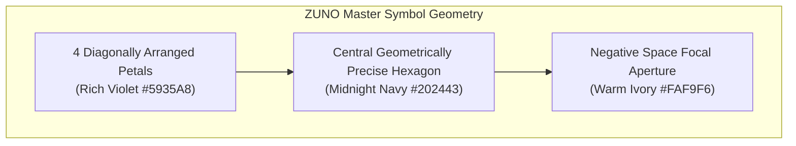

# ZUNO — Brand Identity & Design System

## 1. Brand Overview

**ZUNO** is a modern, offline-first short-form social video discovery platform for Android. The brand identity reflects a calm, focused, and premium discovery experience that brings the fluidity of modern short-form feeds to local personal video collections without distractions, cloud tracking, or algorithms.

---

## 2. Master Brand Symbol & Horizontal Lockup

The ZUNO brand identity centers on a geometrically balanced symbol representing motion, focus, and curated video discovery.

### Visual Assets Reference

| Asset | Path | Description |
| :--- | :--- | :--- |
| **Master Brand Symbol** | `docs/assets/branding/zuno-master-symbol.png` | Standalone geometric icon used for launcher icons, favicons, and splash branding |
| **Horizontal Lockup** | `docs/assets/branding/zuno-horizontal-lockup.png` | Full brand mark with typography for headers, splash screens, and official documentation |
| **Brand Palette Guide** | `docs/assets/branding/zuno-brand-palette.png` | Complete visual guide showing hex values, contrast ratios, and surface hierarchy |
| **Launcher Preview** | `docs/assets/branding/zuno-launcher-preview.png` | Live Android adaptive icon rendered on home screen squircle |

---

## 3. Brand Color Palette

ZUNO features an intentional three-color signature palette engineered for accessible contrast, visual warmth, and optical equilibrium.

| Role | Color Name | Hex Code | RGB | Compose Token |
| :--- | :--- | :--- | :--- | :--- |
| **Primary Accent** | Rich Violet | `#5935A8` | `89, 53, 168` | `ZunoPrimary` |
| **Dark Structure & Text** | Midnight Navy | `#202443` | `32, 36, 67` | `ZunoSecondary` / `ZunoOnBackground` |
| **Base Surface & Canvas** | Warm Ivory | `#FAF9F6` | `250, 249, 246` | `ZunoBackground` / `ZunoOnPrimary` |

### Accessible Contrast Ratios (WCAG 2.1)
- **Rich Violet on Warm Ivory:** $7.5 : 1$ (Exceeds WCAG AAA standard for standard text).
- **Midnight Navy on Warm Ivory:** $13.7 : 1$ (Exceeds WCAG AAA standard for standard text).
- **Muted Navy (`#535670`) on Warm Ivory:** $6.4 : 1$ (Exceeds WCAG AA standard for standard text).

---

## 4. Android Adaptive Launcher Icon

The ZUNO Android adaptive icon is configured in accordance with Google's Android Adaptive Icon guidelines (`mipmap-anydpi-v26`):

- **Background Layer (`ic_launcher_background.xml`):** Solid Warm Ivory (`#FAF9F6`).
- **Foreground Layer (`ic_launcher_foreground.xml`):** Vector representation of the Master Symbol centered at $(54, 54)\,\text{dp}$ in a $108 \times 108\,\text{dp}$ grid. The outer radius is bounded at $30.5\,\text{dp}$, leaving a generous $5.5\,\text{dp}$ safety margin within the $36\,\text{dp}$ Android system circular and squircle mask radius.
- **Monochrome Layer (`ic_launcher_monochrome.xml`):** Single-tint vector silhouette supporting Material You dynamic theming on Android 13+ (API 33+).
- **Legacy Bitmaps:** Multi-density WebP bitmaps (`mdpi`, `hdpi`, `xhdpi`, `xxhdpi`, `xxxhdpi`) generated for legacy Android launchers.

---

## 5. UI Themes

In addition to the signature **ZUNO** default theme, the application supports five alternative themes stored persistently via Jetpack DataStore:

1. **ZUNO (Default):** Rich violet, midnight navy & warm ivory.
2. **Ocean Pop:** Electric blue, sky blue & crisp white.
3. **Sunset Glow:** Vibrant coral, orange & warm peach.
4. **Fresh Mint:** Mint green, emerald & lively white.
5. **Lavender Dream:** Royal lavender, violet & soft pink.
6. **Midnight (Dark):** Obsidian black, electric cyan & violet.
