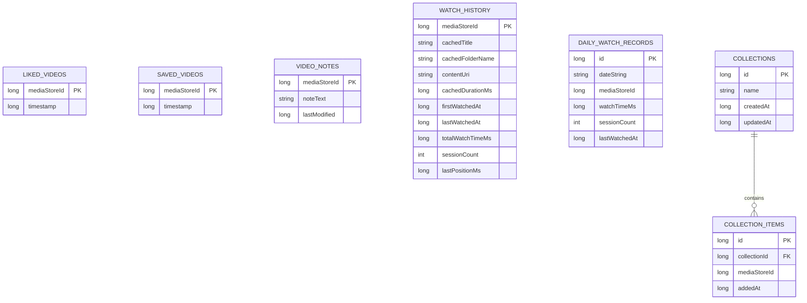

# ZUNO — Room Database & Schema Migrations

## 1. Database Overview

All user interactions, collections, notes, watch history, and analytics in ZUNO are stored locally using **Android Room Database** with SQLite.

- **Database File:** `vscroll_database.db`
- **Current Version:** `5`
- **Data Safety:** Destructive migrations (`fallbackToDestructiveMigration()`) are strictly forbidden. All schema updates use safe migration scripts (`Migration(M, N)`).

---

## 2. Table Specifications & Entities

### A. User Interactions
1. **`liked_videos` (`LikedVideoEntity`):**
   - `mediaStoreId`: Primary key matching Android MediaStore ID.
   - `timestamp`: Timestamp when like occurred.
2. **`saved_videos` (`SavedVideoEntity`):**
   - `mediaStoreId`: Primary key matching Android MediaStore ID.
   - `timestamp`: Timestamp when video was bookmarked.
3. **`video_notes` (`VideoNoteEntity`):**
   - `mediaStoreId`: Primary key matching Android MediaStore ID.
   - `noteText`: Private user-entered note text.
   - `lastModified`: Last edit timestamp.

### B. Analytics & Watch Tracking
4. **`watch_history` (`WatchHistoryEntity`):**
   - Aggregate lifetime playback record per video.
   - Caches metadata (`cachedTitle`, `cachedFolderName`, `contentUri`, `cachedDurationMs`) to gracefully display historical records even if a file is moved or deleted.
5. **`daily_watch_records` (`DailyWatchRecordEntity`):**
   - Daily granular playback records partitioned by `dateString` (`YYYY-MM-DD`).
   - Powers the 7-day bar chart and viewing reminder evaluations.
   - Handles midnight rollover by splitting playback spans across calendar days.

### C. Folder & Collection Management
6. **`collections` (`CollectionEntity`):**
   - Virtual collections created by the user.
   - Distinct from physical Android file system directories.
7. **`collection_items` (`CollectionItemEntity`):**
   - Maps videos into virtual collections.
   - Supports many-to-many relationship: one video can belong to multiple collections.
   - `CollectionWithCount` queries dynamically retrieve the cover thumbnail (`coverVideoId`) from the most recently added video (`MAX(added_at)`) without requiring schema changes or redundant columns.
8. **`folder_custom_names` (`FolderCustomNameEntity`):**
   - Stores custom display aliases for physical storage folders.

---

## 3. Schema Migrations

| Migration | Version Step | Changes Implemented |
| :--- | :--- | :--- |
| **`MIGRATION_1_2`** | $1 \rightarrow 2$ | Created `liked_videos`, `saved_videos`, and `video_notes` tables with indexes. |
| **`MIGRATION_2_3`** | $2 \rightarrow 3$ | Created `watch_history` and `daily_watch_records` tables with date-based composite indices. |
| **`MIGRATION_3_4`** | $3 \rightarrow 4$ | Created `collections`, `collection_items`, and `folder_custom_names` tables with foreign keys and unique constraints. |
| **`MIGRATION_4_5`** | $4 \rightarrow 5$ | Added `reaction_type TEXT` column and index to `video_interactions` table; backfilled existing liked videos with `'LOVE'` to preserve full user interaction history. |

---

## 4. Query Performance & Threading

- **Background Execution:** All DAO queries execute off the main thread via Room coroutines (`suspend`) or Kotlin `Flow`.
- **Compound Indices:** Indexed on `(date_string, media_store_id)` and `(collection_id, media_store_id)` for sub-millisecond query responses across 10,000+ videos.
- **Reactive Updates:** All UI screens observe Room database tables reactively using Room `Flow` queries combined with Kotlin Coroutines `StateFlow`.

