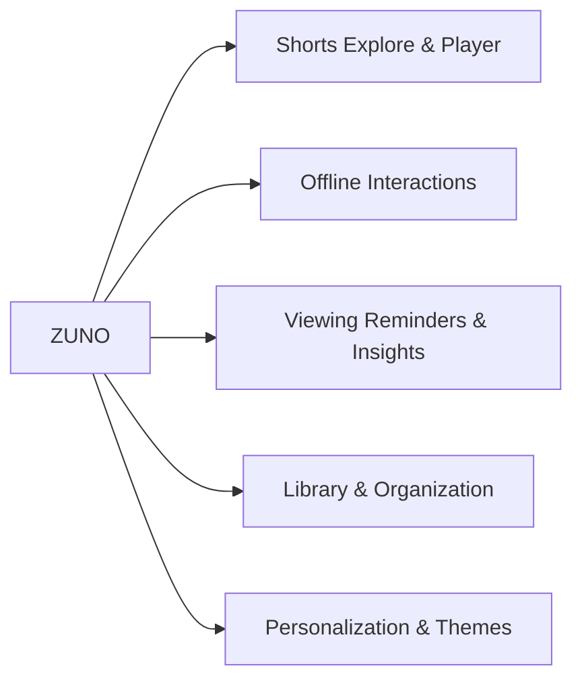

# ZUNO — Feature Catalog & Capabilities

## 1. Feature Overview

ZUNO combines the fluid, addictive discovery experience of modern short-form feeds with complete offline ownership of local video collections.

---

## 2. Shorts Explore Grid & Immersive Playback

- **3-Column Discovery Grid:** Visual exploration inspired by social discovery feeds.
- **Randomized Shuffle Feed:** Dynamic Fisher-Yates shuffle order that avoids immediate repeats across sessions while remaining stable within an active session.
- **Smart Duration Badges:** Highlighting duration (`00:15`, `01:30`) and resolution (`HD`, `FHD`, `4K UHD`).
- **Immersive Video Player:** Instant fullscreen playback on tap with vertical scrolling, swipe gestures, and clean UI without file browser indicators.
- **Gesture HUDs:** Left-side brightness sliding, right-side volume sliding, center scrubbing bar.

---

## 3. Offline Interactions, Reactions & Instagram-Inspired Saved Collections

- **Double-Tap Like & Emoji Reactions:**
  - Double-tap anywhere on the video player displays a smooth scale/fade animated heart centered at the tap coordinate and registers a Like reaction.
  - Six expressive emoji reactions: ❤️ Love, 👍 Like, 😂 Haha, 😮 Wow, 😢 Sad, 🔥 Fire.
  - Long-press the reaction button to reveal a floating horizontal emoji selector with smooth scale animations and haptic feedback.
  - While the reaction selector is open, Notes, Save, and Share controls automatically fade and scale out, preventing visual overlap or clutter.
  - Full-screen outside-tap dismissal barrier consumes taps outside the selector to dismiss it safely without triggering accidental playback pauses, seeks, or control activations.
  - System Back button/gesture dismisses the reaction selector without navigating away from the video.
  - Single tap on Like button toggles like status; badges reflect chosen reaction emoji in Liked thumbnails.
- **Bookmarks / Saved Hub:** Dedicated top-level Saved screen accessible from the Interactions Hub, featuring a minimal header (`Saved` + `+` New Collection action) and dual sub-navigation:
  - **`All Saved`:** Comprehensive chronological view of all bookmarked videos in a responsive 3-column grid with duration pills and quick-remove actions.
  - **`Collections`:** Instagram-inspired 2-column square (1:1) grid showing cover thumbnails of the most recently added video, collection title, video count, and a 3-dots management menu (Rename, Delete).
- **Dedicated Collection Drilldown:** Tapping a collection reveals its dedicated 2-column video grid with simplified video cards (resolution tag, duration pill, video title, 3-dots options menu with "Remove from collection" and "Video details" without distracting play buttons or folder names).
- **Isolated Collection Playback:** Seamless vertical swiping isolated strictly to videos in that collection (`CollectionSequential`), free of position counter badges.
- **Instagram-Inspired Save Bottom Sheet (`SaveToCollectionSheet`):**
  - Instant multi-collection membership toggles with checkmark indicators.
  - One-tap inline collection creation with automatic assignment of the active video.
  - Quick "Remove from Saved" action.
- **Private Video Notes:** Write custom notes, timestamps, or reflections stored alongside any local video.
- **Native Sharing:** Share any offline video via Android's native system sharesheet without network transmission.

---

## 4. Activity Analytics & Detailed Daily Screen-Time Experience

- **Interactive 7-Day Activity Chart:**
  - Daily bars display relative screen time; tapping any day's bar or label highlights it and opens the dedicated Daily Screen-Time detail view for that date.
  - Direct navigation button from "Today's Activity" card to jump straight into today's breakdown.
- **Dedicated Daily Screen-Time Experience:**
  - **Date Selector & Switcher:** Full formatted date display (e.g. `Monday, 16 November 2026`) with quick previous (`<`) and next (`>`) day navigation buttons (future dates disabled) and a 1-tap "Today" return button.
  - **7-Day Day Selector Strip:** Mon-Sun selector strip showing day label and day of month with active day highlighting.
  - **Hero Screen-Time Card:** Bold display of total watch time for the selected day (e.g. `2h 35m` or `0m`).
  - **3-Metric Breakdown:** Videos watched count, average watch time per video, and session count.
  - **Top Video of the Day:** Card showcasing the most-watched video on that date with thumbnail, duration, and 1-tap playback.
  - **Chronological Viewing Timeline:** List of all playback sessions on that date with timestamp badges (`09:15 AM`), video title, folder, and duration pill, or a clean encouraging empty state when no activity was recorded.
- **Neutral Viewing Reminders:** Replace addictive streaks or gamified goals with health-conscious reminders to take a break.
- **Configurable Intervals:** 15 minutes, 30 minutes, 45 minutes, 60 minutes, or Disabled.
- **Eligible Watch-Time Telemetry:** Tracks only genuine foreground playback (excluding pause, buffering, background, or lock screen time).
- **Gentle Break Notifications:** Dispatches a calm Android notification when the threshold is reached.
- **Lifetime Insights:** Lifetime watch duration, unique video count, and average watch time per video.
- **Most Rewatched Videos:** Automatically surfaced ranking of personal favorite videos.

---

## 5. Local Video Organization & Management

- **Physical Folders vs. Virtual Collections:**
  - **Physical Folders:** Reflects real storage directories on Android storage. Supports folder creation and renaming where storage permissions allow.
  - **Virtual Collections:** Lightweight user-curated playlists (e.g. "Favorites", "Gym Motivation", "Tutorials"). A single video can belong to multiple collections without file duplication.
- **Multi-Select Batch Actions:**
  - Multi-select videos from any grid.
  - Add batch to virtual collection.
  - Share batch via Android sharesheet.
  - Delete batch with Android system confirmation dialog.
- **Isolated Collection Playback:** Swiping inside a collection plays only videos belonging to that collection.

---

## 6. Personalization, Themes & Fluid Tab Swiping

- **Five Curated Visual Themes:**
  1. **ZUNO (Default):** Rich violet (`#5935A8`), midnight navy (`#202443`), warm ivory (`#FAF9F6`).
  2. **Sunset Glow:** Vibrant coral, orange, warm peach.
  3. **Fresh Mint:** Mint green, emerald, lively white.
  4. **Lavender Dream:** Royal lavender, violet, soft pink.
  5. **Midnight (Dark):** Obsidian black, electric cyan, violet.
- **Streamlined Single-Row Theme Swatches:** Settings features an ergonomic single-row layout displaying all 5 themes with 44dp gradient swatches, checkmark selection indicators, and crisp titles.
- **Clean Settings Layout:** Removed redundant "100% Offline" card for a distraction-free, focused configuration screen.
- **Directional Horizontal Tab Swiping:**
  - Swipe horizontally anywhere between the five bottom tabs (Shorts ↔ Liked ↔ Activity ↔ Library ↔ Settings).
  - Smooth sliding horizontal animated transition (`slideInHorizontally` + `slideOutHorizontally`).
  - Strict gesture aspect-ratio guard (`abs(dragX) > abs(dragY) * 1.5f` and `touchSlop`) prevents interference with vertical Shorts swiping or vertical list scrolling.
  - Tab state (scroll positions, filters, selections) preserved via Compose `SaveableStateProvider`.
- **Theme Persistence:** Stored persistently using Jetpack DataStore; loads immediately upon app cold start.
- **Clean Viewing Mode:** One-tap distraction-free playback hiding all buttons and overlays.
- **Hardware-Decoded High-Fidelity Video Engine:**
  - Full native resolution preservation from 480p up to 4K 2160p (AV1/HEVC/AVC).
  - Frictionless swipe transition with preloaded adjacent thumbnails and decoder retention.

---

## 7. About ZUNO & Technical Specifications Screen

- **Dedicated In-App Information Hub:** Accessible directly from Settings $\rightarrow$ "About ZUNO" with chevron indicator and Compose `BackHandler` support.
- **App Version & Creator Identity:** Prominently presents ZUNO v1.0.0 (Build 1), Creator: Binay Kushwaha, and core vision statement.
- **Core Architecture & Feature Catalog:** Bulleted summary of 9 core capabilities (Offline Discovery, Jetpack Compose, Media3 Zero-Friction Engine, Reactions & Double-Tap Heart, Instagram-Inspired Saved Collections, Private Notes, Daily Screen-Time & Break Reminders, 5 Curated Themes, Room Database v5).
- **Offline Privacy & Security Commitments:** Transparent declaration of 100% offline architecture, zero internet permission (`android.permission.INTERNET` not requested), read-only MediaStore queries, and sandboxed SQLite storage.
- **Open-Source Software Acknowledgements:** Explicit licensing and attribution for AndroidX Media3 ExoPlayer (Apache 2.0), Jetpack Compose (Apache 2.0), AndroidX Room (Apache 2.0), Kotlin Coroutines (Apache 2.0), Jetpack DataStore (Apache 2.0), and AndroidX Core KTX (Apache 2.0).
- **Source Code & Support:** Direct link to the official GitHub repository (`https://github.com/binaykushwaha1244/ZUNO`).
- **Expandable Technical Build Parameters:** Collapsible technical card detailing Min SDK (26), Target/Compile SDK (37), Room Database Schema Version (5), Android Gradle Plugin (8.9.0), Gradle (9.1.0), Kotlin (2.0.21), and Verified Physical Device (OnePlus Nord CE5, OxygenOS Android 15 API 35).

---

## 8. Unified Theme-Aware Empty States (`EmptyStateView`)

- **Standardized Component Architecture:** Reusable `EmptyStateView` component providing consistent visual hierarchy across empty states.
- **Visual Design:** Centered tinted circular container with theme primary icon, bold title in `titleMedium`, descriptive subtitle in `bodyMedium`, and optional elevated action button.
- **Contextual Deployment:**
  - **Folders Tab:** Displayed when no storage directories containing videos are detected, offering a "Create Folder" action.
  - **Collections Tab:** Displayed when no virtual collections exist, offering a "Create Collection" action.
  - **Videos Grid / Search Results:** Displayed when a folder, collection, or search query returns zero matching videos.
  - **Interactions Tabs:** Displayed in Liked, Saved, or Notes when no matching items exist or search filters return empty.

