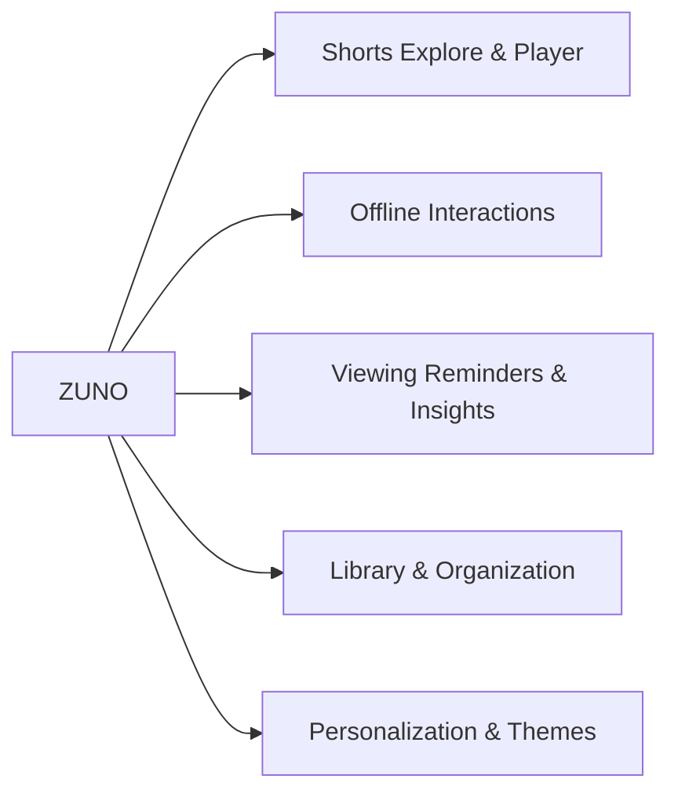

# ZUNO — Feature Catalog & Capabilities

## 1. Feature Overview

ZUNO combines the fluid, addictive discovery experience of modern short-form feeds with complete offline ownership of local video collections.

---

## 2. Shorts Explore Grid & Immersive Playback

- **3-Column Discovery Grid:** Visual exploration inspired by social discovery feeds.
- **Randomized Shuffle Feed:** Dynamic Fisher-Yates shuffle order that avoids immediate repeats across sessions while remaining stable within an active session.
- **Smart Duration Badges:** Highlighting duration (`00:15`, `01:30`) and resolution (`HD`, `FHD`, `4K UHD`).
- **Immersive Video Player:** Instant fullscreen playback on tap with vertical scrolling, swipe gestures, and clean UI without file browser indicators.
- **Gesture HUDs:** Left-side brightness sliding, right-side volume sliding, center scrubbing bar.

---

## 3. Offline Interactions (Room-Powered)

- **Likes:** Heart videos with single tap on player overlay or double-tap anywhere on screen with an animated particle burst.
- **Bookmarks / Saved:** Save videos into a dedicated offline bookmarks collection.
- **Private Video Notes:** Write custom notes, timestamps, or reflections stored alongside any local video.
- **Interactions Hub:** Dedicated tab with segmented filters (`Liked`, `Saved`, `Notes`) for rapid review.
- **Native Sharing:** Share any offline video via Android's native system sharesheet without network transmission.

---

## 4. Activity Analytics & Viewing Reminders

- **Neutral Viewing Reminders:** Replace addictive streaks or gamified goals with health-conscious reminders to take a break.
- **Configurable Intervals:** 15 minutes, 30 minutes, 45 minutes, 60 minutes, or Disabled.
- **Eligible Watch-Time Telemetry:** Tracks only genuine foreground playback (excluding pause, buffering, background, or lock screen time).
- **Gentle Break Notifications:** Dispatches a calm Android notification when the threshold is reached.
- **7-Day Activity Chart:** Normalized daily bars displaying daily watch time and session counts.
- **Lifetime Insights:** Lifetime watch duration, unique video count, and average watch time per video.
- **Most Rewatched Videos:** Automatically surfaced ranking of personal favorite videos.

---

## 5. Local Video Organization & Management

- **Physical Folders vs. Virtual Collections:**
  - **Physical Folders:** Reflects real storage directories on Android storage. Supports folder creation and renaming where storage permissions allow.
  - **Virtual Collections:** Lightweight user-curated playlists (e.g. "Favorites", "Gym Motivation", "Tutorials"). A single video can belong to multiple collections without file duplication.
- **Multi-Select Batch Actions:**
  - Multi-select videos from any grid.
  - Add batch to virtual collection.
  - Share batch via Android sharesheet.
  - Delete batch with Android system confirmation dialog.
- **Isolated Collection Playback:** Swiping inside a collection plays only videos belonging to that collection.

---

## 6. Personalization & Design System

- **Six Distinct Visual Themes:**
  1. **ZUNO (Default):** Rich violet (`#5935A8`), midnight navy (`#202443`), warm ivory (`#FAF9F6`).
  2. **Ocean Pop:** Electric blue, sky blue, crisp white.
  3. **Sunset Glow:** Vibrant coral, orange, warm peach.
  4. **Fresh Mint:** Mint green, emerald, lively white.
  5. **Lavender Dream:** Royal lavender, violet, soft pink.
  6. **Midnight (Dark):** Obsidian black, electric cyan, violet.
- **Theme Persistence:** Stored persistently using Jetpack DataStore; loads immediately upon app cold start.
- **Clean Viewing Mode:** One-tap distraction-free playback hiding all buttons and overlays.
