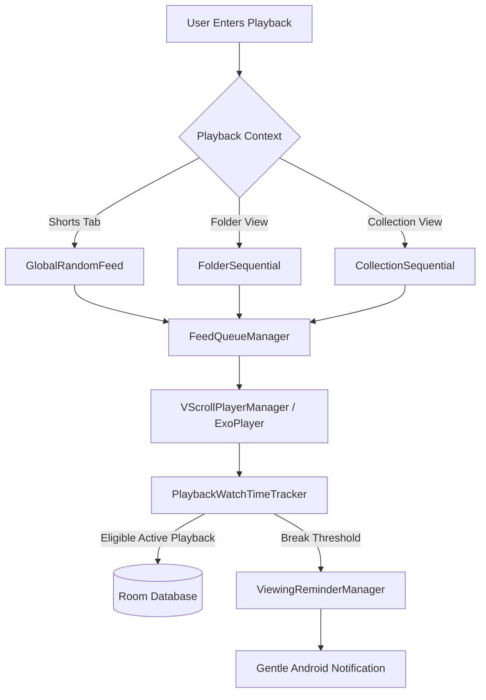

# ZUNO — Playback Architecture & Queue Isolation

## 1. Playback Architecture Overview

Video playback in ZUNO is powered by **AndroidX Media3 ExoPlayer** wrapped inside `VScrollPlayerManager` and observed by `PlaybackWatchTimeTracker`.

---

## 2. The Three Isolated Playback Contexts

A critical architectural feature of ZUNO is strict queue isolation. When viewing a specific folder or collection, swiping to the next video **never** pulls videos from outside that specific container.

| Playback Context | Trigger Destination | Queue Sorting & Shuffling | Boundary Behavior |
| :--- | :--- | :--- | :--- |
| **`GlobalRandomFeed`** | Shorts Explore Grid | Fisher-Yates shuffle with session persistence across app restarts | Loops indefinitely or scrolls through entire local library |
| **`FolderSequential`** | Folder Detail Screen | Respects user's folder sort order (Date, Name, Size, Duration) | Isolated strictly to videos inside that specific physical storage folder |
| **`CollectionSequential`** | Virtual Collection Screen | Ordered by collection insertion sequence | Isolated strictly to videos tagged within that virtual collection |

### `FeedQueueManager` Guarantees
- **Isolation Enforcement:** A swipe in a folder view cannot escape into the global explore feed.
- **Index Safety:** Queue indices are verified and clamped on insertion, deletion, or sorting changes.
- **Seamless Resume:** Opening a video from history or search sets the appropriate context without corrupting other queues.

---

## 3. Media3 ExoPlayer Lifecycle & Resource Management

- **Single Active Player Instance:** Exactly one ExoPlayer instance exists per playback surface to preserve device RAM and hardware decoder limits.
- **Audio Focus Management:** Automatically pauses playback when audio focus is lost (e.g. incoming phone call) and resumes smoothly when focus is regained.
- **Video Surface Scaling:** Automatically adjusts between `RESIZE_MODE_FIT` (for full aspect preservation) and `RESIZE_MODE_ZOOM` (for full-screen immersive filling).
- **Background Release:** When the application is sent to the background or the screen locks, playback is paused immediately and decoders are safely idled.

---

## 4. Advanced Interaction & Gesture Controls

| Gesture | Region | Action |
| :--- | :--- | :--- |
| **Vertical Swipe** | Entire Screen | Navigate to Next / Previous video in the isolated queue |
| **Single Tap** | Center | Toggle Play / Pause with animated feedback icon |
| **Double Tap** | Center | Instantly Like video with animated heart burst |
| **Left Vertical Drag** | Left 35% of screen | Adjust screen brightness with real-time HUD indicator |
| **Right Vertical Drag** | Right 35% of screen | Adjust media volume with real-time HUD indicator |
| **Horizontal Drag** | Center 30% of screen | Scrub playback position forward / backward with timestamp overlay |
| **Long Press** | Right Panel Toggle | Enable Clean Viewing Mode (hides all overlays and bottom nav) |

---

## 5. Clean Viewing Mode

Clean Viewing Mode removes all distracting UI elements (interaction buttons, video titles, folder badges, and navigation bars) to provide an unobstructed video watching experience.
- Can be toggled from the player overlay button or via the Settings tab.
- Preference is persistently saved in DataStore.
