# ZUNO — Testing Architecture & Verification Protocols

## 1. Automated Testing Architecture

ZUNO maintains a comprehensive automated testing suite written with JUnit 4, Kotlin Coroutines Test (`kotlinx-coroutines-test`), and Mockito / in-memory DAO fakes.

- **Total Test Cases:** **121 Passed / 0 Failed (100% Pass Rate)**
- **Execution Command:** `.\gradlew.bat test`
- **Execution Time:** ~5–10 seconds

```mermaid
graph TD
    A[Unit Test Suite - 121 Tests] --> B[Room Database & Migrations v5]
    A --> C[Feed Queue Isolation & Shuffling]
    A --> D[Watch Time Tracking & Deduplication]
    A --> E[Viewing Reminder & Notification Policies]
    A --> F[Folder & Collection Organization]
    A --> G[5 Curated Themes & Ocean Pop Fallback]
    A --> H[Playback State & First Frame Transitions]
    A --> I[InteractionSequential Queue Isolation]
    A --> J[Saved Collections Refinement & Sheets]
    A --> K[Emoji Reactions & Double-Tap Heart]
    A --> L[Daily Screen-Time Breakdown & Timeline]
```

---

## 2. Test Suites Summary

| Test File | Package | Focus Area | Test Count |
| :--- | :--- | :--- | :--- |
| **`Milestone7Tests.kt`** | `data.local` | Watch History recording, 7-day breakdowns, lifetime analytics, queue isolation, sharing | 30 |
| **`Milestone8Tests.kt`** | `data.local` | Virtual collections, many-to-many items, folder renaming, physical folder isolation | 20 |
| **`SavedCollectionsRefinementTest.kt`** | `data.local` | Instagram-inspired collections, 1:1 covers, multi-collection membership, queue isolation | 10 |
| **`FinalEnhancementFeaturesTest.kt`** | `com.binay.vscroll` | 6 Emoji reactions, set/toggle reactions, reaction picker overlay & outside-tap dismissal state machine, 5 curated themes, daily screen time session aggregation & top video calculation, 5-tab ordering | 7 |
| **`VideoInteractionRepositoryTest.kt`** | `data.local` | Room database interactions, likes, bookmarks, private notes, search filtering | 12 |
| **`ViewingReminderManagerTest.kt`** | `data.notification` | Break reminder thresholds, duplicate prevention, daily re-arming, exception safety | 6 |
| **`FeedQueueManagerTest.kt`** | `domain.model` | Shorts queue shuffling, context switching, queue isolation, Liked/Saved/Notes sequential queue | 16 |
| **`HomeViewModelTest.kt`** | `ui.home` | All 5 theme modes existence, UI state mappings, video sorting orders | 5 |
| **`MainScreenViewModelTest.kt`** | `ui.main` | Navigation destinations, backstack handling, bottom bar selection | 2 |
| **`PlayerPlaybackStateTest.kt`** | `ui.player` | Playback state transitions, seeking & progress math, 10s skip clamping, volume/brightness HUD states, first-frame rendered transitions, 5 theme verification | 13 |

---

## 3. Physical Device Verification Protocols

All releases are verified on a connected physical hardware device:

- **Hardware:** OnePlus Nord CE5 (Physical Hardware)
- **OS:** Android 15 (API 35) / OxygenOS
- **Test Matrix Executed:**
  1. **Settings Theme Selector 2-Row Grid:** Verified all 6 themes render in a responsive 2-row layout with zero character wrapping, crisp 46dp gradient swatches, and full label visibility.
  2. **Theme Switching & Persistence:** Verified all 6 themes dynamically recolor top app bars, bottom navigation, cards, sheets, buttons, and system status bars, and persist across process kill.
  3. **Original Video Quality Preservation:** Verified full original stream playback without downscaling across all tiers:
     - 480p SD (480x864 AVC)
     - 720p HD (720x1280 AVC)
     - 1080p FHD (1920x1080 HEVC / AVC)
     - 4K UHD 2160p (3840x2160 AV1 hardware decoded natively at 100% resolution in ~302ms)
  4. **Swipe Transition Fluidity & Zero-Spinner Performance:**
     - Verified elimination of false buffering spinner flashes upon swipe.
     - Confirmed seamless thumbnail placeholder retention until first hardware frame renders.
     - Executed 20 rapid video swipes in under 10 seconds: zero crashes, zero decoder drops, stable ~33MB Dalvik heap.
  5. **MediaStore Refresh Optimization:** Verified full rescan of 1,818 videos across 90 folders executes in ~142ms total (129ms query + 13ms single-pass grouping).
  6. **Viewing Reminder Notifications:** Set 15m reminder, verified threshold triggered notification dialog, granted permission, and verified notification posted in system shade.
  7. **Queue Isolation:** Swiped through folder view and confirmed 100% isolation within folder bounds.
  8. **Instagram-Inspired Saved Collections Verification:**
     - Verified minimal header (`Saved` + `+` button), dual tabs `All Saved` & `Collections`.
     - Verified 2-column collection grid with 1:1 square cover thumbnails, collection title, video count, and 3-dots menu.
     - Verified dedicated collection drilldown screen with simplified video cards (resolution tag, duration pill, title, options menu without distracting play buttons or folder names).
     - Verified isolated sequential playback within collection (`CollectionSequential`) without position counter badges.
     - Verified `SaveToCollectionSheet` with instant multi-collection toggling, checkmark indicators, and inline collection creation with automatic item membership.
     - Verified safe in-place APK upgrade preserving all 1,823 media files, likes, bookmarks, and notes.
  9. **Emoji Reactions & Dismissal Overlay Verification:**
     - Verified long-press on Like button smoothly animates open the 6-emoji reaction pill (`❤️`, `👍`, `😂`, `😮`, `😢`, `🔥`).
     - Verified Notes, Save, and Share buttons completely fade out / scale down while reaction selector is open, preventing visual overlap.
     - Verified full-screen touch scrim dismisses picker without triggering video pause, seek, or button clicks.
     - Verified system back gesture dismisses the reaction picker cleanly.
  10. **About ZUNO & Technical Specifications Screen:**
      - Verified dedicated navigation from Settings $\rightarrow$ "About ZUNO" row with system chevron.
      - Confirmed display of App Info (v1.0.0, Build 1, Creator: Binay Kushwaha), 9 Core Features, 100% Offline Privacy guarantee, 6 Open-Source Library Licenses, Support links, and expandable Technical Build Parameters.
      - Verified Compose BackHandler returns seamlessly to Settings without navigation stack leaks.
  11. **Unified Theme-Aware Empty States (`EmptyStateView`):**
      - Verified centered tinted icon surface, bold typography, and contextual action buttons across empty Folders, empty Collections, and empty Video search/filter results.
  12. **Room Database Integrity:** Verified all 1,818 local videos, Likes (4), Bookmarks (2), and Notes (1) remained intact after in-place APK installation.
  13. **Airplane Mode:** Verified full offline playback and interaction recording while disconnected from all mobile data and Wi-Fi networks.

