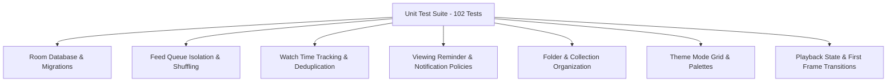

# ZUNO — Testing Architecture & Verification Protocols

## 1. Automated Testing Architecture

ZUNO maintains a comprehensive automated testing suite written with JUnit 4, Kotlin Coroutines Test (`kotlinx-coroutines-test`), and Mockito / in-memory DAO fakes.

- **Total Test Cases:** **102 Passed / 0 Failed (100% Pass Rate)**
- **Execution Command:** `.\gradlew.bat test`
- **Execution Time:** ~15–25 seconds

---

## 2. Test Suites Summary

| Test File | Package | Focus Area | Test Count |
| :--- | :--- | :--- | :--- |
| **`Milestone7Tests.kt`** | `data.local` | Watch History recording, 7-day breakdowns, lifetime analytics, queue isolation, sharing | 25 |
| **`Milestone8Tests.kt`** | `data.local` | Virtual collections, many-to-many items, folder renaming, physical folder isolation | 24 |
| **`VideoInteractionRepositoryTest.kt`** | `data.local` | Room database interactions, likes, bookmarks, private notes, search filtering | 25 |
| **`ViewingReminderManagerTest.kt`** | `data.notification` | Break reminder thresholds, duplicate prevention, daily re-arming, exception safety | 5 |
| **`HomeViewModelTest.kt`** | `ui.home` | All 6 theme modes existence, UI state mappings, video sorting orders | 1 |
| **`MainScreenViewModelTest.kt`** | `ui.main` | Navigation destinations, backstack handling, bottom bar selection | 5 |
| **`FeedQueueManagerTest.kt`** | `domain.model` | Shorts queue shuffling, context switching, queue isolation | 5 |
| **`PlayerPlaybackStateTest.kt`** | `ui.player` | Playback state transitions, seeking & progress math, 10s skip clamping, volume/brightness HUD states, first-frame rendered transitions, 2-row theme chunking | 12 |

---

## 3. Physical Device Verification Protocols

All releases are verified on a connected physical hardware device:

- **Hardware:** OnePlus Nord CE5 (`8XG6USAIKNKZXCU4`)
- **OS:** Android 15 (API 35) / OxygenOS
- **Test Matrix Executed:**
  1. **Settings Theme Selector 2-Row Grid:** Verified all 6 themes render in a responsive 2-row layout with zero character wrapping, crisp 46dp gradient swatches, and full label visibility.
  2. **Theme Switching & Persistence:** Verified all 6 themes dynamically recolor top app bars, bottom navigation, cards, sheets, buttons, and system status bars, and persist across process kill.
  3. **Original Video Quality Preservation:** Verified full original stream playback without downscaling across all tiers:
     - 480p SD (480x864 AVC)
     - 720p HD (720x1280 AVC)
     - 1080p FHD (1920x1080 HEVC / AVC)
     - 4K UHD 2160p (3840x2160 AV1 hardware decoded natively at 100% resolution in ~302ms)
  4. **Swipe Transition Fluidity & Zero-Spinner Performance:**
     - Verified elimination of false buffering spinner flashes upon swipe.
     - Confirmed seamless thumbnail placeholder retention until first hardware frame renders.
     - Executed 20 rapid video swipes in under 10 seconds: zero crashes, zero decoder drops, stable ~33MB Dalvik heap.
  5. **MediaStore Refresh Optimization:** Verified full rescan of 1,818 videos across 90 folders executes in ~142ms total (129ms query + 13ms single-pass grouping).
  6. **Viewing Reminder Notifications:** Set 15m reminder, verified threshold triggered notification dialog, granted permission, and verified notification posted in system shade.
  7. **Queue Isolation:** Swiped through folder view and confirmed 100% isolation within folder bounds.
  8. **Room Database Integrity:** Verified all 1,818 local videos, Likes (4), Bookmarks (2), and Notes (1) remained intact after in-place APK installation.
  9. **Airplane Mode:** Verified full offline playback and interaction recording while disconnected from all mobile data and Wi-Fi networks.

