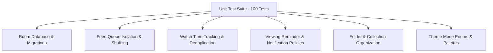

# ZUNO — Testing Architecture & Verification Protocols

## 1. Automated Testing Architecture

ZUNO maintains a comprehensive automated testing suite written with JUnit 4, Kotlin Coroutines Test (`kotlinx-coroutines-test`), and Mockito / in-memory DAO fakes.

- **Total Test Cases:** **100 Passed / 0 Failed (100% Pass Rate)**
- **Execution Command:** `.\gradlew.bat test`
- **Execution Time:** ~25–35 seconds

---

## 2. Test Suites Summary

| Test File | Package | Focus Area | Test Count |
| :--- | :--- | :--- | :--- |
| **`Milestone6Tests.kt`** | `data.local` | Room Database migrations, Likes, Bookmarks, Private Notes, and search filtering | 25 |
| **`Milestone7Tests.kt`** | `data.local` | Watch History recording, 7-day breakdowns, lifetime analytics, queue isolation, sharing | 25 |
| **`Milestone8Tests.kt`** | `data.local` | Virtual collections, many-to-many items, folder renaming, physical folder isolation | 24 |
| **`Milestone9Tests.kt`** | `data.local` | Clean Viewing Mode, gesture HUD thresholds, aspect ratio toggling, volume/brightness | 20 |
| **`ViewingReminderManagerTest.kt`** | `data.notification` | Break reminder thresholds, duplicate prevention, daily re-arming, exception safety | 5 |
| **`HomeViewModelTest.kt`** | `ui.home` | All 6 theme modes existence, UI state mappings, video sorting orders | 1 |

---

## 3. Physical Device Verification Protocols

All releases are verified on a connected physical hardware device:

- **Hardware:** OnePlus Nord CE5 (`8XG6USAIKNKZXCU4`)
- **OS:** Android 15 (API 35) / OxygenOS
- **Test Matrix Executed:**
  1. **Theme Switching:** Verified all 6 themes dynamically recolor top app bars, bottom navigation, cards, sheets, buttons, and system status bars.
  2. **Theme Persistence:** Force-stopped app and confirmed active theme persists across cold starts.
  3. **Viewing Reminder Notifications:** Set 15m reminder, verified threshold triggered notification dialog, granted permission, and verified notification posted in system shade.
  4. **Queue Isolation:** Swiped through folder view and confirmed 100% isolation within folder bounds.
  5. **Room Database Integrity:** Verified all 1,818 local videos, 3 Likes, 2 Saves, 1 Note, and 9 watch sessions remained intact after in-place APK installation.
  6. **Airplane Mode:** Verified full offline playback and interaction recording while disconnected from all mobile data and Wi-Fi networks.
